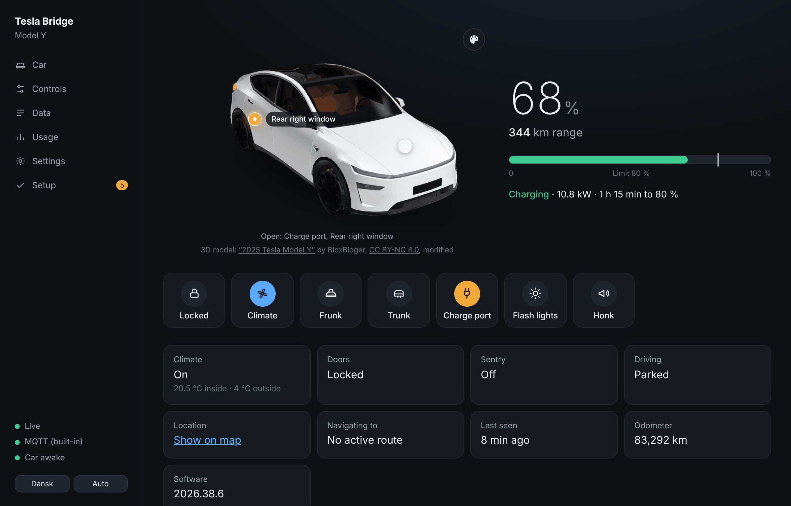
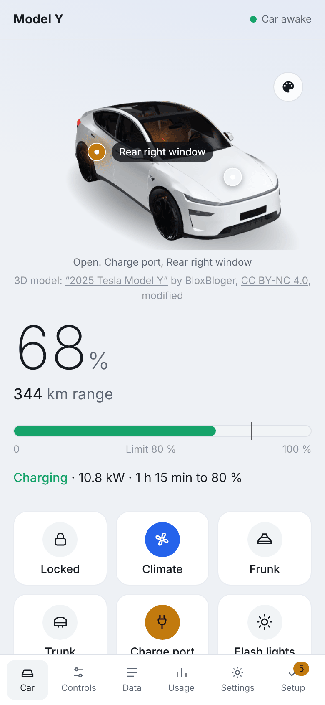
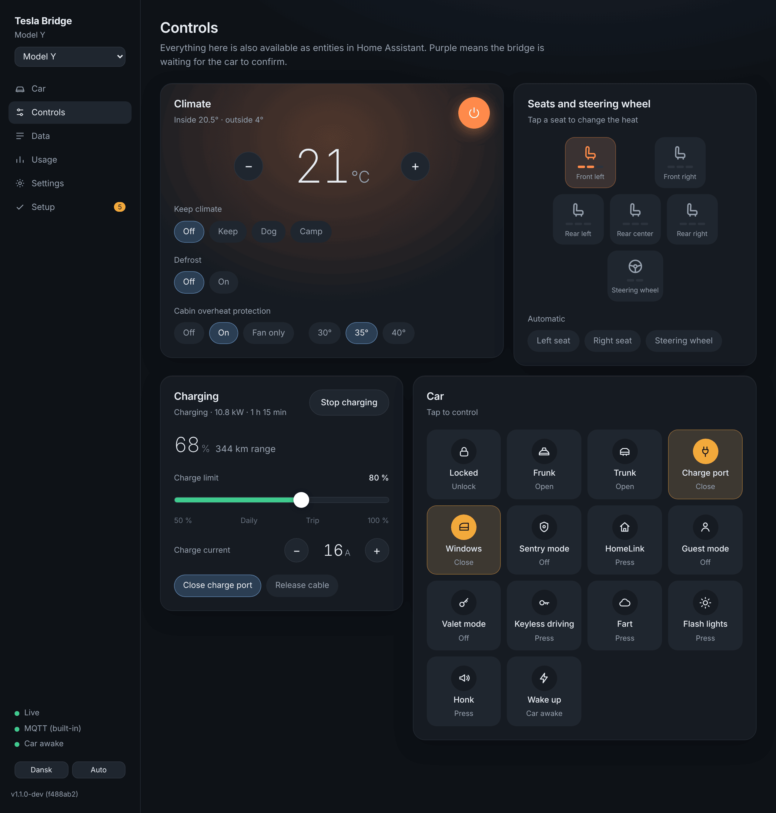
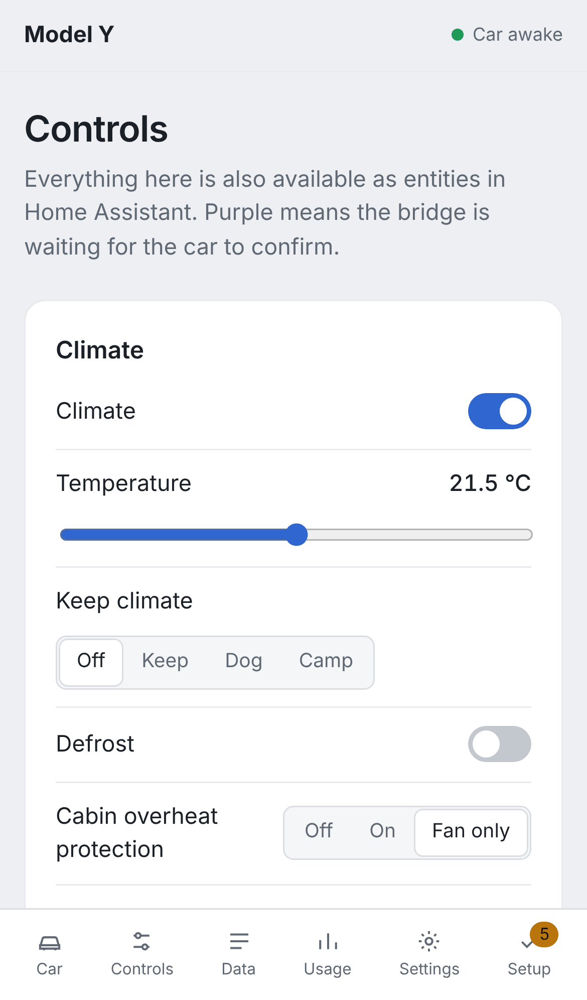
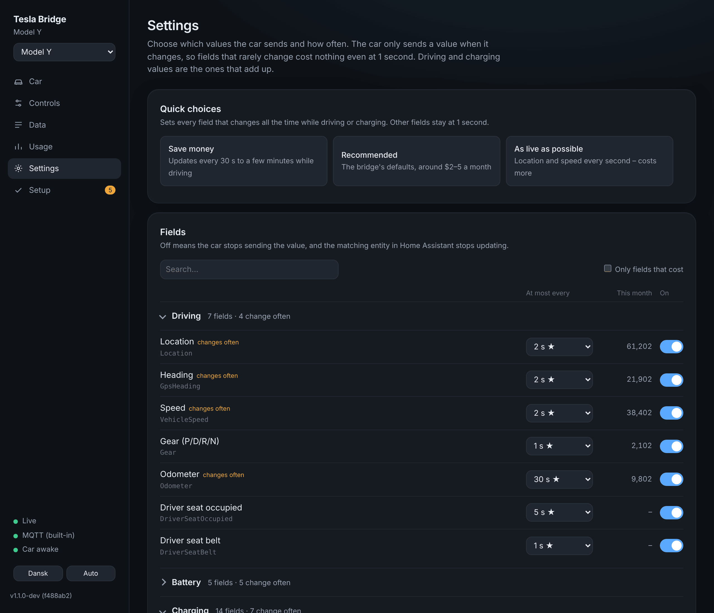
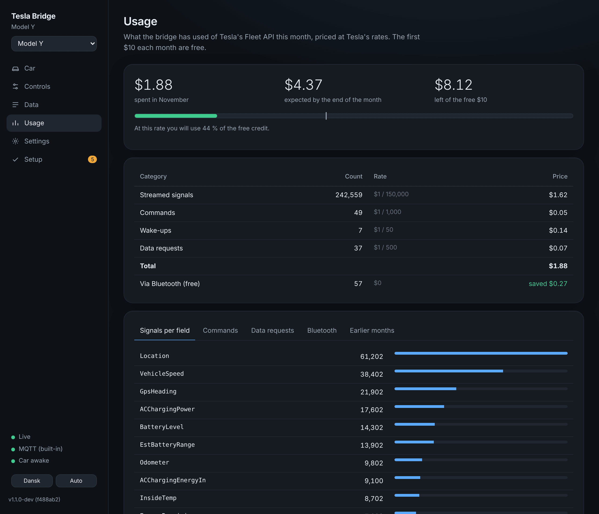

# Tesla Bridge

A self-hosted replacement for Teslemetry. Your car streams directly to your own server, and you control it through Tesla's official Fleet API – no middleman, no subscription. Fleet API usage for one car stays within Tesla's free monthly credit ($10), and the bridge tracks it for you.

- **Home Assistant your way:** through your MQTT broker, or a real integration without one. Same entities either way, named like Teslemetry's.
- **Feels instant:** commands show up straight away, locks and covers show *locking*/*opening*, a sleeping car is woken and the command resent.
- **Its own dashboard:** the car in 3D, controls, live data, usage and settings – also without Home Assistant.
- **Your choice how often:** pick per value how often the car sends it, with a live cost estimate.

<table>
<tr>
<td width="66%"></td>
<td></td>
</tr>
<tr>
<td><b>Car</b> – the car in 3D with open doors, windows, frunk, trunk and charge port live; battery, range and charging; quick actions.</td>
<td><b>On a phone</b></td>
</tr>
<tr>
<td></td>
<td></td>
</tr>
<tr>
<td><b>Controls</b> – everything Home Assistant can do, with the car's current state.</td>
<td></td>
</tr>
<tr>
<td></td>
<td></td>
</tr>
<tr>
<td><b>Settings</b> – how often the car sends each value, with this month's signal count and a cost estimate.</td>
<td><b>Usage</b> – Fleet API cost this month and the projection.</td>
</tr>
</table>

<sub>Screenshots use test data from the built-in simulator. 3D model: “2025 Tesla Model Y” by BloxBloger, CC BY-NC 4.0, modified – see <a href="docs/5-the-dashboard.md#credits">credits</a>.</sub>

## Get started

> **The easy way:** the **[interactive setup guide](https://mfoldager17.github.io/tesla-bridge/)** asks the three questions below and shows only the steps for your setup – with your own domain filled into every command.

### Three choices

Each one is independent – any combination works. If you're unsure, take the first option in each row.

| Choice | Option 1 | Option 2 |
|---|---|---|
| **How do you install?** | **Setup script** – one command that asks and does the rest | **By hand** – every step explained |
| **How does the internet reach your server?** | **Reverse proxy** – port 443 is open to Nginx Proxy Manager, Caddy, Traefik … | **Tunnel** – e.g. Cloudflare Tunnel, port 443 stays closed |
| **How does Home Assistant get the data?** | **Integration** – from HACS, no broker needed | **MQTT** – through the broker you already run |

Whatever you pick, the car always needs **TCP 4443 forwarded** to your server, and a **certificate** for the name it connects to. Nginx Proxy Manager is *not* required – but you need to know which folder your certificate is in. [Why?](docs/1-before-you-start.md#choice-1-how-the-internet-reaches-you)

### The route

| | Step | What happens | Depends on your choice |
|:-:|---|---|---|
| 1 | **[Before you start](docs/1-before-you-start.md)** | What you need and how it fits together | Reverse proxy: one domain · Tunnel: two |
| 2 | **[Install](docs/2-install.md)** | Tesla app, DNS, `.env`, certificate, start | [Script](docs/2-install.md#with-the-setup-script) · [by hand](docs/2-install.md#by-hand) |
| 3 | **[Connect the car](docs/3-connect-the-car.md)** | Sign in with Tesla, pair the key at the car | – |
| 4 | **[Home Assistant](docs/4-home-assistant.md)** | Entities in Home Assistant | [MQTT](docs/4-home-assistant.md#a-mqtt) · [Integration](docs/4-home-assistant.md#b-the-tesla-bridge-integration) |
| 5 | **[The dashboard](docs/5-the-dashboard.md)** | Controls, intervals per value, the 3D car | – |

Each page ends with a link to the next one.

### Already know what you're doing?

On the server:

```bash
curl -fsSL https://raw.githubusercontent.com/Mfoldager17/tesla-bridge/main/install.sh | bash
```

## Reference

| | |
|---|---|
| [Entities](docs/entities.md) | Everything you get in Home Assistant |
| [Switching](docs/switching.md) | From MQTT to the integration and back |
| [Updating](docs/updating.md) | New versions and pinning one |
| [Troubleshooting](docs/troubleshooting.md) | Symptoms and what to check |
| [MQTT API](docs/mqtt-api.md) · [HTTP API](docs/http-api.md) | For ESP32 panels, Node-RED and scripts |
| [Development](docs/development.md) | Run it locally with the simulator, project layout, tests |

Tesla and Model Y are trademarks of Tesla, Inc. This project is not affiliated with Tesla.
