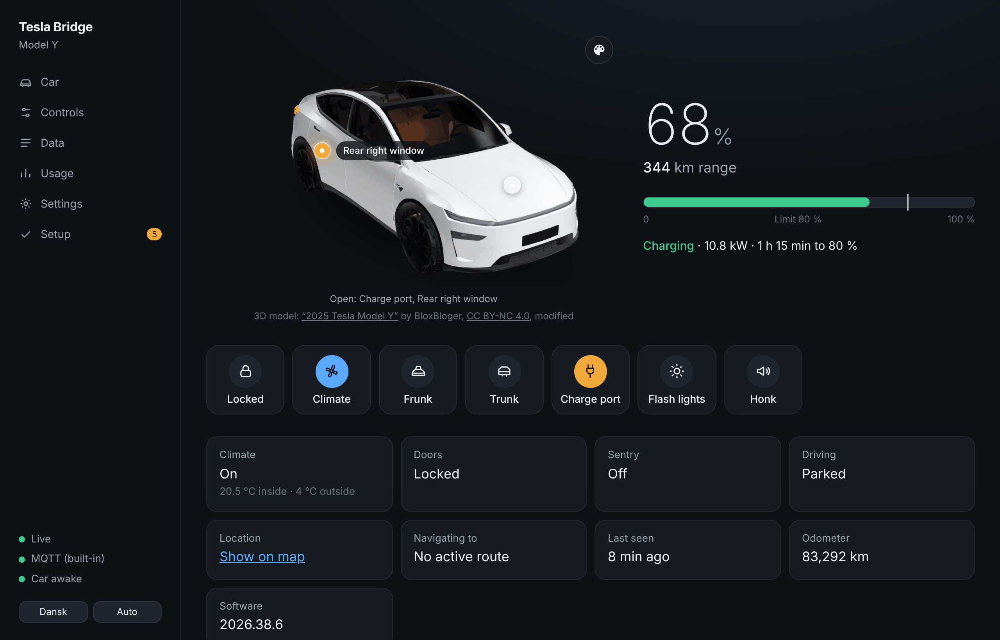

[Tesla Bridge](../README.md) · [Guide](README.md) · [Before you start](1-before-you-start.md) → [Install](2-install.md) → [Connect the car](3-connect-the-car.md) → [Home Assistant](4-home-assistant.md) → **The dashboard**

# 5. The dashboard

The bridge has a built-in dashboard at `http://<server-IP>:8090` (`http://localhost:8080` when testing locally). It works on a phone too, follows your system's light/dark mode, and is in English or Danish (switch in the sidebar).

- **Car**: the car in 3D – or a drawing, see [Car view](#car-view-3d-model-or-drawing) – showing open doors, frunk, trunk, windows and the charge cable live, the battery with range and charge limit, quick actions, and the latest commands with their status (*sent → waking the car → done/failed*)
- **Controls**: everything you can do from Home Assistant – climate, Keep/Dog/Camp, seat and steering wheel heat, charging, locks, sentry, guest/valet mode, frunk, trunk, windows, HomeLink. Purple means the bridge is waiting for the car to confirm
- **Data**: every value with its source (`stream`, `snapshot`, `optimistic`, `restored`, `bridge`) and age, the raw telemetry exactly as the car sent it, and the telemetry status on the car
- **Usage**: the month's signals, commands, wakes and data requests, priced at Tesla's rates, with a projection to the end of the month
- **Settings**: how often the car sends each value, and how often a snapshot is fetched – see [Fields and intervals](#fields-and-intervals)
- **Setup**: domain, Tesla login, pairing and telemetry status, step by step

## Car view: 3D model or drawing

Under **Settings → Car view** you choose what the Car page shows:

| Option | |
|---|---|
| **Model Y in 3D** (default) | The Model Y that ships with the bridge. It turns slowly, you can drag it around, doors swing open when they are open, wheels spin while driving, the cabin glows warm or cool when climate is on, and you can tap the frunk, trunk and charge port to open them. A palette button changes the paint and interior colour |
| **Your own 3D model** | Upload a `.glb` of your own car – same features if it is prepared as described below |
| **Drawing** | A simple top-down drawing. No 3D, light on old devices |

If a 3D model can't be loaded (or the device has no WebGL), the page shows the drawing.

**Your own model.** Upload a glTF binary (`.glb`, up to 80 MB) under Settings – it is saved as `data/car-model.glb` – or put the file on the server as `config/bridge/car.glb`. Convert `.obj`, `.fbx` or `.gltf` in Blender (*File → Export → glTF 2.0*, format *glTF Binary*). Any `.glb` is shown; for the animations and colour picker, name the parts like this:

| What | Name |
|---|---|
| Doors (rotate around Y) | nodes `door_fl`, `door_fr`, `door_rl`, `door_rr` |
| Wheels (spin around X) | nodes `wheel_fl`, `wheel_fr`, `wheel_rl`, `wheel_rr` |
| Body colour | materials `paint` (and `jamb` for door jambs) |
| Interior colour | materials `seats` (and `trim2`) |
| Orientation | front towards +Z, driver's side (left) towards +X, wheels on Y = 0, metres |

Other `.glb` files are kept out of Git and out of images you build yourself (`.gitignore`, `.dockerignore`), so a model you bought can't end up public by accident. Check the licence before you share a model.

**Credits.** The bundled model is [“2025 Tesla Model Y”](https://sketchfab.com/3d-models/2025-tesla-model-y-619601e7800d418da5922c4fa7833f74) by **BloxBloger**, licensed under [CC BY-NC 4.0](https://creativecommons.org/licenses/by-nc/4.0/), modified for Tesla Bridge (converted to `.glb`, simplified, doors, wheels and seats split into animatable parts, new materials). The model is **not** covered by the rest of this repository's licence and may only be used non-commercially – see [`NOTICE.md`](../src/TeslaBridge/wwwroot/models/NOTICE.md). The 3D view uses [three.js](https://threejs.org) (MIT), bundled in the image so it works without internet. Tesla and Model Y are trademarks of Tesla, Inc.; this project is not affiliated with Tesla.

The dashboard can unlock your car. Always set `Bridge__Web__Token`, and **never forward port 8090**. The public port 8091 only answers with the public key and the login callback. `Bridge__Web__Enabled=false` turns off the dashboard and the HTTP API – way B then stops working.

## Fields and intervals

Open **Settings** in the dashboard to choose which values the car sends and how often at most. The car **only sends a value when it changes**, so:
- discrete values (lock, doors, climate, charging state, gear) are set to 1 s and feel live at no extra cost
- values that change all the time while driving or charging (location, speed, battery, charging power, temperatures, tire pressure) are the ones that cost. They are marked *changes often*

The page shows how many signals each field has sent this month and estimates the monthly streaming cost as you change things. Three quick choices set all the costly fields at once: **Save money**, **Recommended** (the defaults) and **As live as possible**. Turning a field off stops the car from sending it, and the matching entity in Home Assistant stops updating.

**Save and send to car** stores the settings in `data/settings.json` (kept across updates) and sends the new configuration to the car right away. If the car or Tesla can't be reached, the bridge sends it on its next check (within 12 hours). **Reset to defaults** goes back to the intervals shipped with the bridge.

The same page sets how often the bridge fetches a **snapshot** from the Fleet API when the car wakes up (default: at most once an hour, or never). A snapshot fills in values the car hasn't streamed yet, costs one data request and never wakes the car.

## Seat and steering-wheel heat

The car only heats the seats and the steering wheel while the climate is on, and refuses otherwise. By default the bridge does what the Tesla app does: it turns the climate on first. The Controls page says so under *Seats and steering wheel* while the climate is off, and the command log shows the extra *ClimateOn* with a note. Prefer it not to? **Settings → Seat and steering-wheel heat → Nothing** makes such a command fail with an explanation instead. This applies to Home Assistant and automations too.

## Bluetooth (ESP32)

**Settings → Bluetooth (ESP32)** is where you connect an optional ESP32 near where the car parks. While the car is in range, commands and wake-ups go over Bluetooth for free. The panel shows whether the ESP32 is reachable and sees the car, and has buttons to pair it with the car and to test a wake-up. **Usage** shows what went over Bluetooth this month and what it saved. The whole setup is in [Bluetooth (ESP32)](ble.md).

The defaults live in `config/bridge/telemetry-fields.json` in the image. Fields the bridge doesn't know pass through unchanged as `snake_case` (e.g. `TpmsPressureFl` → `tpms_pressure_fl`). Valid names are in Tesla's [vehicle_data.proto](https://github.com/teslamotors/fleet-telemetry/blob/main/protos/vehicle_data.proto).

---

**You're done.** 🎉 From here on:

| | |
|---|---|
| [Updating](updating.md) | New versions, pinning a version, updating the integration |
| [Entities](entities.md) | Everything you get in Home Assistant |
| [Troubleshooting](troubleshooting.md) | When something doesn't work |
| [MQTT API](mqtt-api.md) · [HTTP API](http-api.md) | For ESP32 panels, Node-RED, scripts |
| [Switching](switching.md) | Moving between MQTT and the integration |
